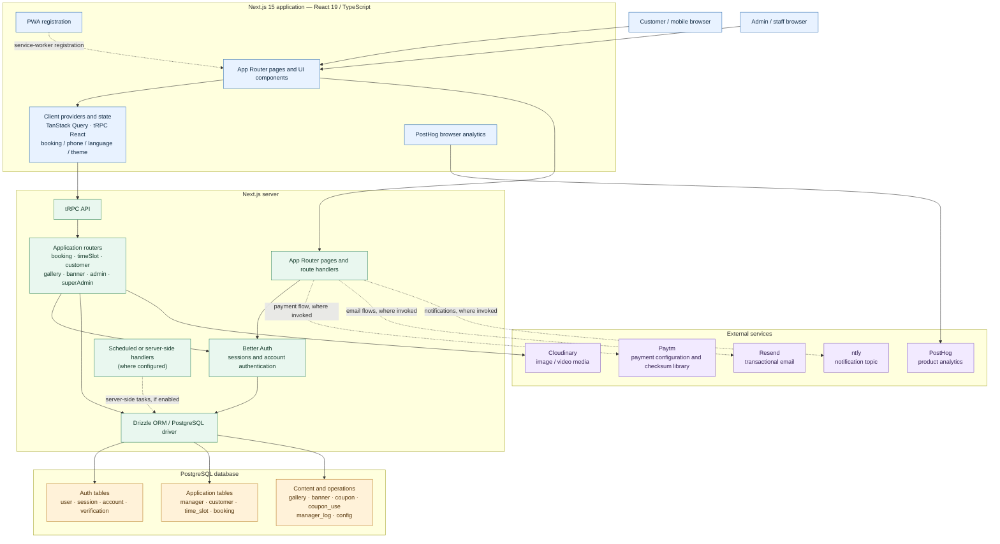

# Pitch Perfect — Architecture

This diagram is based on the repository's current `package.json`, Next.js root layout, tRPC router registry, environment schema, and Drizzle schema. It distinguishes application components from external services.

## System architecture

## Request and data flow

1. The customer or staff member opens the responsive Next.js application.
2. Client components use the tRPC React integration and TanStack Query for typed API calls and client-side query caching.
3. The tRPC root router dispatches requests to the registered booking, time-slot, customer, gallery, banner, admin, super-admin, and post routers.
4. Server-side business logic uses Drizzle ORM and the PostgreSQL driver to access the database. Better Auth provides authentication/session handling and stores its auth records in PostgreSQL.
5. Media records reference Cloudinary assets. The repository also configures Paytm, Resend, ntfy, and PostHog integration settings/libraries; the exact runtime call paths should be verified in their respective implementation files before treating every integration as active in every flow.

## Verified implementation details

- **Web framework:** Next.js 15 App Router, React 19, TypeScript.
- **API:** tRPC v11 with TanStack Query and SuperJSON.
- **Database:** PostgreSQL through `postgres` and Drizzle ORM.
- **Authentication:** Better Auth; auth schema includes `user`, `session`, `account`, and `verification`.
- **Booking domain:** customer, time slot, booking, coupon, coupon use, configuration, manager, gallery, banner, and manager log tables are defined in `src/server/db/schema.ts`.
- **Media and observability:** Cloudinary and PostHog are configured.
- **Operational integrations:** environment validation includes Paytm, Resend, and ntfy configuration.

## Source files

- [Application router registry](../src/server/api/root.ts)
- [Database schema](../src/server/db/schema.ts)
- [Environment configuration](../src/env.js)
- [Root application layout and providers](../src/app/layout.tsx)
- [Dependencies and scripts](../package.json)

> **Accuracy note:** This is a repository-derived logical architecture, not a deployment topology. It does not assert a separate microservice, queue, or worker. External-service arrows marked “where invoked” indicate configured integrations, not proof that every flow is currently enabled in production.
